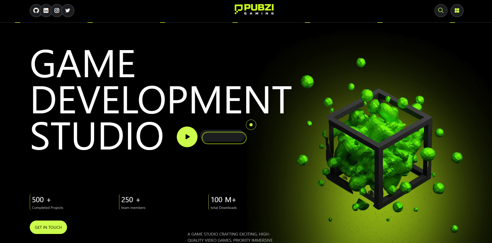
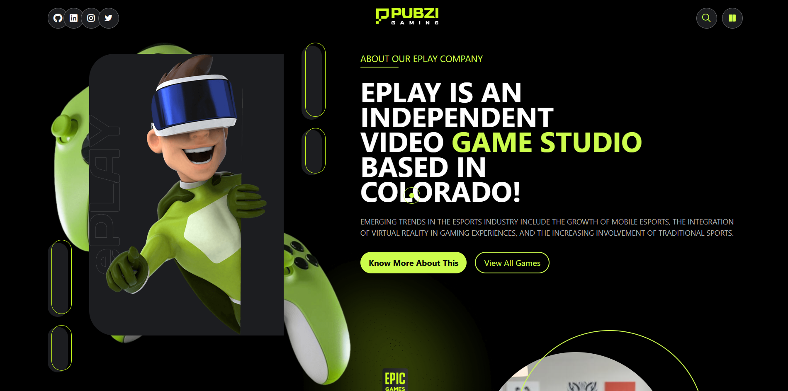

# Pubzi-Website | eSports & Gaming Studio Landing Page

A fully responsive, interactive landing page for a fictional game development studio — built entirely with vanilla JavaScript, Tailwind CSS v4, and Swiper.js. Features a custom dual-circle cursor, scroll-reveal animations, an interactive game showcase slider, opposing infinite marquees, and animated service cards with L-shaped corner brackets that respond to hover.

<p dir="rtl" align="right">
یک Landing Page کاملاً واکنش‌گرا و تعاملی برای یک استودیوی توسعه‌ی بازی (Game Development Studio)؛ ساخته‌شده به‌طور کامل با JavaScript(vanilla)، Tailwind CSS نسخه ۴ و Swiper.js. این صفحه شامل سیستم کرسر سفارشی دو‌دایره‌ای، انیمیشن‌های ظاهر‌شدن مبتنی بر اسکرول، اسلایدر تعاملی نمایش بازی‌ها، دو ردیف مارکی بی‌نهایت با جهت‌های مخالف و کارت‌های خدمات تعاملی با براکت‌های زاویه‌ای L‌ شکل است که به hover پاسخ می‌دهند.
</p>

## Table of Contents
- [Demo](#demo)
- [Features](#features)
- [Screenshots](#screenshots)
- [Tech Stack](#tech-stack)
- [Project Structure](#project-structure)
- [Author](#author)

## Demo
[Live Demo](https://ali-mirzaei-dev.github.io/Pubzi-Website/)

## Features

- **Custom Dual-Circle Cursor | کرسر سفارشی دو‌دایره‌ای:**

  <p dir="rtl" align="right">
  مخفی کردن کرسر پیش‌فرض مرورگر و جایگزینی آن با دو دایره (یک دایره کوچک توپر و یک حلقه بزرگ) که با حرکت موس هماهنگ حرکت می‌کنند. این سیستم با استفاده از <code dir="ltr">mousemove</code> و <code dir="ltr">transform: translate</code> پیاده‌سازی شده و روی کل صفحه فعال است.
  </p>

- **Animated Counter Stats | شمارنده‌های متحرک:**

  <p dir="rtl" align="right">
  سه آمار کلیدی هیرو (۵۰۰+ پروژه، ۲۵۰+ عضو تیم، ۱۰۰M+ دانلود) به‌محض لود صفحه با استفاده از <code dir="ltr">setInterval</code> شروع به شمارش می‌کنند. هر شمارنده سرعت متفاوتی دارد (۰ms، ۸ms و ۱۸ms) تا حس پویایی طبیعی‌تری ایجاد شود و به‌صورت ناهمزمان به عدد نهایی برسند.
  </p>

- **Scroll-Reveal Animations | انیمیشن‌های ظاهر‌شدن اسکرولی:**

  <p dir="rtl" align="right">
  با استفاده از <code dir="ltr">IntersectionObserver</code>، عناصر با کلاس <code dir="ltr">.reveal</code> زمانی که ۵۰٪ آن‌ها وارد viewport شود، از حالت کم‌رنگ و پایین‌تر (translateY(5px)) به حالت کاملاً واضح و بالاتر (translateY(-5px)) در می‌آیند. هر عنصر با استفاده از متغیر CSS <code dir="ltr">--d</code> یک تأخیر پله‌ای (stagger) اختصاصی دارد تا انیمیشن‌ها به‌صورت آبشاری اجرا شوند.
  </p>

- **Interactive Game Showcase Slider | اسلایدر تعاملی نمایش بازی‌ها:**

  <p dir="rtl" align="right">
  اسلایدر بازی‌ها با Swiper.js پیاده‌سازی شده و شامل قابلیت‌های loop، autoplay با تأخیر ۳ ثانیه‌ای، breakpoints واکنش‌گرا (۱ اسلاید در موبایل، ۲ در تبلت) و دکمه‌های prev/next سفارشی است. pagination dots نیز استایل‌شده‌اند تا dot فعال به‌شکل یک قرص سبز لیمویی (lime pill) درآید.
  </p>

- **Dual Opposing Logo Marquees | دو مارکی لوگوی مخالف:**

  <p dir="rtl" align="right">
  دو ردیف لوگوی بی‌نهایت که در جهت‌های مخالف حرکت می‌کنند — ردیف بالا به‌سمت چپ و ردیف پایین به‌سمت راست. هر ردیف از دو مجموعه‌ی یکسان تصاویر تشکیل شده و با تکنیک <code dir="ltr">translateX(-50%)</code> یک حلقه بی‌درنگ و بدون پرش ایجاد می‌کند. با hover روی هر ردیف، انیمیشن متوقف می‌شود.
  </p>

- **Interactive Service Cards | کارت‌های خدمات تعاملی:**

  <p dir="rtl" align="right">
  کارت‌های خدمات با براکت‌های زاویه‌ای L‌شکل در گوشه‌ی بالا-چپ و پایین-راست تزئین شده‌اند. با hover، این براکت‌ها بزرگ‌تر شده و رنگ آن‌ها از خاکستری تیره به سبز لیمویی تغییر می‌کند. آیکون دایره‌ای داخل کارت نیز با <code dir="ltr">rotateY(360deg)</code> می‌چرخد و یک لایه‌ی پس‌زمینه‌ی سبز از بالا به پایین (scaleY) ظاهر می‌شود.
  </p>

- **Image Swap on News Cards | انیمیشن جابه‌جایی تصویر کارت‌های اخبار:**

  <p dir="rtl" align="right">
  با hover روی کارت‌های اخبار، تصویر با یک انیمیشن سریع swap جایگزین می‌شود: تصویر به‌سمت چپ خارج می‌شود، در نقطه‌ی میانی نامرئی می‌شود، سپس از سمت راست دوباره وارد می‌شود. این تکنیک با استفاده از کلیدفریم <code dir="ltr">49% → 50%</code> که در آن opacity صفر است، تلپورت نامرئی تصویر را ممکن می‌کند.
  </p>

- **Custom Animated Borders | حاشیه‌های متحرک سفارشی:**

  <p dir="rtl" align="right">
  حاشیه‌های نقطه‌چین متحرک با استفاده از <code dir="ltr">repeating-linear-gradient</code> و انیمیشن <code dir="ltr">background-position</code> ساخته شده‌اند. حاشیه‌ی بالا به‌سمت راست و حاشیه‌ی پایین به‌سمت چپ حرکت می‌کنند تا یک حس تقارن پویا ایجاد شود. از <code dir="ltr">prefers-reduced-motion</code> پشتیبانی می‌کند تا برای کاربرانی که انیمیشن را غیرفعال کرده‌اند، متوقف شوند.
  </p>

- **Fully Responsive | کاملاً واکنش‌گرا:**

  <p dir="rtl" align="right">
  طراحی موبایل-اول با breakpointهای دقیق برای تبلت (<code dir="ltr">md</code>) و دسکتاپ (<code dir="ltr">lg</code> و <code dir="ltr">xl</code>). همه‌ی بخش‌ها از گرید ۸ ستونه در موبایل تا ۴ ستونه در دسکتاپ، و از اسلایدر ۱ اسلایدی تا ۲ اسلایدی به‌خوبی سازگار می‌شوند.
  </p>

## Screenshots

<table>
  <tr>
    <td width="50%">
      
    </td>
    <td width="50%">
      
    </td>
  </tr>
  <tr>
    <td align="center"><b>Hero Section</b></td>
    <td align="center"><b>Games Showcase</b></td>
  </tr>
</table>

## Tech Stack

| Technology | Purpose |
|---|---|
| HTML 5 | Semantic markup & DOM structure |
| Tailwind CSS v4 | Utility-first styling, `@theme` block, custom arbitrary values, RTL-aware components |
| JavaScript (Vanilla) | Custom cursor, animated counters, IntersectionObserver scroll reveals, Swiper config |
| Swiper.js v12 | Games showcase slider & logo carousel with autoplay, loop, breakpoints |
| SVG / Pseudo-elements | L-shaped corner brackets, lime underlines, decorative masks, animated dashed borders |

## Project Structure

```text
Pubzi-Website/
│
├── assets/
│   ├── Images/
│   ├── Font/
│   │ 
│   ├── JavaScript/
│   │   └── main.js            
│   │ 
│   └── StyleSheet/
│       └── master.css
│       └── output.css
│
└── index.html
```

## Author

**Ali Mirzaei** – Frontend Developer

- [GitHub](https://github.com/ali-mirzaei-dev)
- [LinkedIn](https://www.linkedin.com/in/ali-mirzaei-dev/)
- [Instagram](https://instagram.com/ali.mirzaei.dev)
- [ali.mirzaei.kt@gmail.com](mailto:ali.mirzaei.kt@gmail.com)